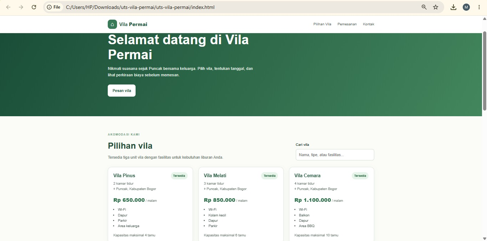
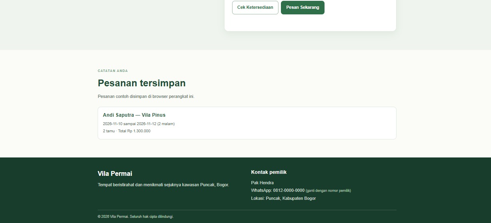

# Vila Permai – Aplikasi Pemesanan Vila

**Nama mahasiswa:** [Jilan Harliana]  
**NIM:** [24011130451]  
**Nama repository:** `uts-vila-permai-24011130451`

## Deskripsi
Website statis untuk menampilkan tiga unit Vila Permai di kawasan Puncak, Kabupaten Bogor. Pengunjung dapat mencari vila, mengisi tanggal menginap, melihat perkiraan biaya otomatis, memeriksa bentrok pesanan yang tersimpan di browser, dan menyimpan pesanan secara lokal.

## Cara menjalankan
1. Unduh atau clone repository ini.
2. Buka folder `uts-vila-permai`.
3. Klik dua kali file `index.html`, atau buka melalui browser seperti Google Chrome.
4. Tidak diperlukan instalasi, server, maupun database.

## Fitur yang sudah tersedia
- [x] Tiga kartu vila dibuat dinamis dari array objek JavaScript.
- [x] Pencarian vila berdasarkan nama, tipe, lokasi, dan fasilitas.
- [x] Form nama, check-in, check-out, jumlah tamu, dan pilihan unit vila.
- [x] Validasi tanggal, nama, jumlah tamu, dan kapasitas vila.
- [x] Perhitungan jumlah malam dan total harga otomatis.
- [x] Pemeriksaan bentrok tanggal berdasarkan pesanan di browser yang sama.
- [x] Penyimpanan pesanan dan nama tamu terakhir menggunakan `localStorage`.
- [x] Tampilan responsif untuk ponsel, tablet, dan laptop.

## Batasan yang belum tersedia
- [ ] Sinkronisasi pesanan antarperangkat atau antar-browser.
- [ ] Pembayaran online dan konfirmasi otomatis.
- [ ] Data ketersediaan real-time dari server.
- [ ] Pengelolaan pesanan oleh pemilik melalui halaman admin.

> **Catatan penting:** Aplikasi ini tidak menggunakan back-end atau database. Data pesanan hanya tersimpan pada browser/perangkat yang digunakan. Karena itu, pemeriksaan bentrok tidak menjamin ketersediaan real-time untuk pengunjung lain. Hubungi pemilik untuk konfirmasi akhir.

## Screenshot
Tambahkan tangkapan layar halaman website ke folder repository, misalnya dengan nama `screenshot.png`, lalu tampilkan menggunakan:

```md

```

## Teknologi
- HTML5
- CSS3
- JavaScript (tanpa framework)
- localStorage browser

## Screenshot Website

### Halaman Utama


### Formulir Pemesanan


### Hasil Pemesanan
